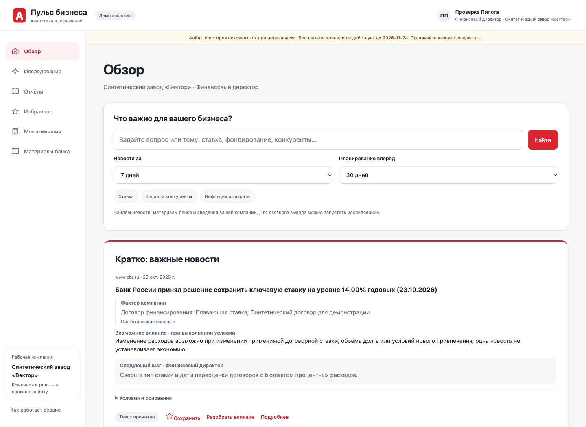
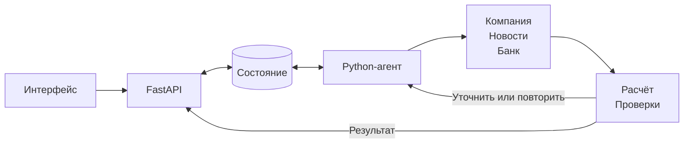

# Пульс бизнеса

**Новость → контекст компании → аналитика Альфа-Банка → последствия и действия для руководителя.**

Рабочий прототип для кейса «Новостная аналитика для принятия бизнес-решений». Целевой пользователь — человек, принимающий решения в крупной компании с выручкой свыше 15 млрд руб. Одна новость может требовать разных действий от CFO, казначея и коммерческого директора: сервис учитывает компанию, роль, документы и подтверждённые условия бизнеса.

**[Открыть демо](https://alfa-business-pulse.onrender.com)** · [Исходники работающего демо](https://github.com/andreiczh/alfa-news-analytics/tree/d38f3236d078c4f6d3fc61c460365de8c0c67489) · [ТЗ кейса](docs/source-materials/case.pdf)

**Тестовый вход: `We2B` / `alfa-case`.** Пространство общее: используйте вымышленные данные. В локальной базе этот облачный аккаунт не создаётся автоматически.

[Возможности](#возможности) · [Пример аналитики](#пример-аналитики) · [Архитектура](#архитектура-и-агент) · [Запуск](#запуск) · [Проверка](#сценарий-проверки) · [Критерии кейса](#соответствие-критериям-кейса)

## Возможности

Сервис помогает перейти от потока публикаций к управленческому вопросу: **что произошло, почему это касается нашей компании, что говорит банк, какой эффект возможен и что нужно проверить перед решением**. Экономия времени и финансовый эффект для клиентов пока не измерены.

| Возможность | Результат для пользователя |
|---|---|
| Персональный обзор | Краткая сводка важных событий, полная подборка, даты, источники и объяснение приоритета |
| Поиск одной строкой | Новости, банковские материалы и точные фрагменты собственных документов по вопросу пользователя |
| Своя компания | Профиль из документов и AI-интервью; просмотр, исправление и отдельное подтверждение сведений |
| Исследование | Связный вывод, основания, риски, возможности, условные сценарии и следующий шаг |
| Банковская библиотека | Подбор материалов Альфа-Банка под компанию и роль; отделение исторических оценок и прогнозов |
| Работа с результатом | Уточняющие вопросы, исходный или актуальный контекст, избранное, история, Markdown/JSON и отзыв |
| Финансирование | Подтверждаемый договор и разные сценарии плавающей, фиксированной и неизвестной ставки |

Роли: **CFO** — бюджет и финансирование; **казначей** — ликвидность и сроки; **CEO** — приоритеты и стратегические риски; **COO** — операции и оборотный капитал; **CCO** — спрос, цены и продажи; **CMO** — аудитория, конкуренты и позиционирование. Своя должность получает общий срез. Профессиональная роль не меняет права доступа.



*Экран работающего демо, синтетическая компания. Состав новостей зависит от даты и доступности издателей.*

## Пример аналитики

**Событие:** [публикация ЦБ от 23.10.2026 о сохранении ключевой ставки](https://www.cbr.ru/press/PR/?file=23102026_133000key.htm). **Контекст:** синтетическая производственная компания подтвердила плавающий рублёвый долг, бенчмарк и дату переоценки. **Основание банка:** в [«Тактическом взгляде на 3-й квартал 2026»](https://drive.google.com/file/d/1hq3Fhyz9ce_sRyGUQB1MdoHeQdfAJfhK/view?usp=drivesdk) от 22.07.2026 описаны разные механизмы фиксированного и переменного купона; цитата «купон привязан к уровню ключевой ставки или RUONIA» используется как основание проверить формулу договора.

Собственный вывод сервиса: **пауза не создаёт нового повышения ставки**. Для действующего плавающего долга нужно проверить договор и сроки переоценки; для фиксированного — границы защиты; новое привлечение и рефинансирование оцениваются отдельно. Обзор облигаций не подменяет кредитный договор, а позиция банка сохраняет свою дату.

| Условия компании | Допустимый вывод | Что проверить |
|---|---|---|
| Плавающая ставка, данные достаточны | Чувствительность к условному изменению договорной ставки; фактический эффект новости не установлен | Бенчмарк, дату переоценки, остаток, погашение и хедж |
| Фиксированная ставка, защита подтверждена | Рыночный стресс не меняет договорную ставку в защищённом периоде | Пересмотр ставки, окончание фиксации, рефинансирование |
| Тип ставки или условия неизвестны | Денежный эффект не рассчитывается; неизвестное не заменяется нулём | Недостающие условия договора |
| Компания — банк | Корпоративная формула блокируется | ALM-модель активов и обязательств, сроки переоценки и ликвидность |

**Воспроизводимый численный пример.** Окно 26.10.2026–23.01.2027, остаток 200 млн руб., переоценка 25.11.2026, погашение позже окна, остаток постоянен, хедж отсутствует. Экспозиция — 60 дней. При изменении **договорной** ставки на −1 / 0 / +1 п.п. изменение процентных расходов: **−328 767,12 / 0 / +328 767,12 руб.**

Формула: `остаток × изменение ставки в п.п. / 100 × дни / 365`. День погашения исключается; после погашения условия нового привлечения неизвестны. RUONIA не приравнивается к ключевой ставке. Это ACT/365 чувствительность одного договора, не прогноз ставки, чистой прибыли или достаточности денег. Сценарный ноль не означает нулевой эффект для всей компании.

**CFO:** сопоставить чувствительность с бюджетом процентных расходов и условиями нового привлечения. **Казначей:** сверить переоценку и погашение с платёжным календарём, остатками и доступными линиями. В отчёте видны исходные условия, цитата банка, собственная интерпретация и пробелы; без достаточных оснований результат остаётся частичным.

## Данные и персонализация

| Источник | Что используется |
|---|---|
| `df_Uid_data_hack.csv` | 85 525 строк, 85 514 уникальных ID компаний: отрасль, масштаб, регион, продукты и другие признаки |
| `df_Uid_payment_hack.csv` | 1 380 585 строк наблюдаемых платёжных связей; входящие/исходящие связи, отдельное отображение платежей себе |
| `df_Fid_Uid_link_hack.csv` | 12 514 строк связей физических и юридических лиц; связь не объявляется доказательством контроля |
| Материалы Альфа-Банка | Девять PDF, 64 страницы OCR; 27 структурированных тезисов: 24 из четырёх PDF и три исходных тезиса |
| Материалы пользователя | PDF, DOCX, PPTX, XLSX, TXT, MD, CSV: текст, цитаты, страницы/локаторы и предложения полей профиля |
| Внешние новости | RSS ЦБ, РБК, Интерфакса и Bing News по публичному имени компании; ограниченное чтение HTTPS-статей |

CSV включены в `data/case/`, индекс проверяет их хеши. Повторяющиеся и конфликтные записи сохраняются; неопределённые единицы и периоды показываются как ограничение источника. Обезличенные ID не сопоставляются с реальными работодателями догадкой: свою компанию пользователь создаёт отдельно. Платёжные суммы не равны выручке, наличие кредита не сообщает остаток/валюту/формулу ставки, `NEGATIVEMARK` не трактуется как негативный кредитный риск. **Достоверная доля рынка без полного знаменателя не рассчитывается.**

Из файлов и диалога формируется контекст: деятельность, продукты, рынки, аудитория, конкуренты, цели, финансы, риски и пользовательские поля. Предложения AI доступны для проверки и исправления; неподтверждённый диалог не меняет аналитический контекст. Исключённый файл перестаёт участвовать в новом анализе, старый отчёт сохраняет исходный снимок. Условия договора пользователь подтверждает отдельно; полное автоматическое извлечение кредитного договора не заявляется.

Загрузка ограничена 15 МБ на файл; PDF — до 40 страниц, распознавание — до восьми сканированных страниц. Изображения/диаграммы DOCX и PPTX не превращаются в подтверждённые численные данные; формулы и макросы не исполняются.

**Отбор новостей:** нормализация источников и дат → проверка свежести → объединение копий → сопоставление сущности, отрасли, подтверждённых факторов и интересов → ролевой приоритет → чтение выбранных статей. Весовой скоринг учитывает связь с компанией, её экспозиции, приоритеты роли и свежесть; анонсы и общие обновления сайта понижаются. Неизвестная/будущая дата не становится свежей датой; заголовок остаётся наводкой, пока статья не прочитана. Балл 0–100 — приоритет проверки по правилам команды, не вероятность или сумма эффекта. Период новостей 7/30/90 дней отделён от горизонта планирования 7/30/90/365 дней; конфликт с периодом в вопросе требует выбора.

**Происхождение вывода:** цитата источника, позиция банка, прогноз, условный сценарий и интерпретация сервиса различаются. Банковские тезисы сохраняют дату, страницу, SHA-256, тип, авторство и условия. Новые цитаты сверены с OCR и изображениями страниц с помощью AI; это не независимая человеческая экспертиза (`human_verified=false`). Полная разметка всех Document/Claim/Relation/Issue не завершена.

## Архитектура и агент

**Стек:** Python, FastAPI, Pydantic, HTTPX, PostgreSQL, SQLite/FTS5, HTML/CSS/JavaScript. Собственный агент написан командой на Python; OpenClaw, LangChain/LangGraph и готовые агентские runtime не используются.



**Цикл агента:** LLM строит план → Python выполняет допустимые действия → сохраняет наблюдения и цитаты → выбирается механизм влияния → собирается аналитика → сервер и отдельный LLM-вызов проверяют результат → публикация, пересмотр плана или уточнение.

| Инструмент | Назначение |
|---|---|
| `company` | Получить профиль и релевантные фрагменты подтверждённого контекста |
| `bank` | Найти структурированные тезисы и страницы предоставленных материалов банка |
| `public` | Найти доступные публичные источники |
| `read_source` | Прочитать источник и получить текст для цитирования |
| `write` | Выбрать основания и механизмы для сборки вывода |
| `ask_user` | Запросить недостающие сведения и продолжить после ответа |

Состояние хранит вопрос, компанию/роль, снимок профиля, периоды, план, источники, цитаты с ID, наблюдения, вопросы, счётчики, проверки и результат. Есть ожидание ответа, частичный результат, отказ проверки и отложенное выполнение при исчерпании бюджета. Уточнение создаёт связанный отчёт с исходным либо актуальным контекстом; предыдущий результат не переписывается.

**Самопроверка меняет действия:** если оснований нет или механизм не соответствует цитатам, агент повторяет поиск/выбор либо запрашивает данные. Недоступный источник не заменяется выдуманным фактом. Сервер проверяет ID и дословность цитат, даты, числа, единицы, применимость механизма и условия. Для покрытых сценариев ставки/долга расчёт и ограниченную аргументацию формирует код; остальные вопросы используют проверяемый LLM-черновик. Одобрение LLM не отменяет серверный запрет и не является экспертной проверкой истинности.

Промпты: [план](src/alfa_agent/prompts/research_plan.md), [выбор оснований](src/alfa_agent/prompts/research_write.md), [аргументация](src/alfa_agent/prompts/research_narrative.md), [проверка](src/alfa_agent/prompts/research_verify.md), [интервью](src/alfa_agent/prompts/context_interview.md), [извлечение профиля](src/alfa_agent/prompts/profile_extractor.md). Ответы валидируются типизированными JSON-контрактами.

Основные модули: `case_data.py` — CSV; `ingestion.py`/`company_dialogue.py` — документы и контекст; `news*.py` — сбор и ранжирование; `bank_library.py` — банковские основания; `research.py`/`research_rules.py` — агент; `funding.py`/`rate_policy.py` — финансовые правила; `storage.py`/`postgres.py`/`worker.py` — состояние и очередь; `api.py`/`static/` — интерфейс.

### ИИ, бюджет и безопасность

Подключение: **`https://changellenge.up.railway.app/v1`**, OpenAI-compatible API организаторов. Серверный allowlist содержит только шесть разрешённых ID:

- `z-ai/glm-5.3-flash` — по умолчанию исследование и извлечение профиля;
- `qwen/qwen3.6-35b-a3b` — по умолчанию отдельный расчётный сценарий;
- `qwen/qwen3-vl-30b-a3b-instruct` — сканированные PDF;
- `google/gemma-4-26b-a4b-it`, `deepseek/deepseek-v4.1-flash`, `moonshotai/kimi-k2.6` — доступные разрешённые альтернативы.

Банковский OCR подготовлен заранее локальным Apple Vision; runtime сканов использует разрешённую VL-модель. Внешние AI-поиск, embedding API и AI-ранжирование не подключены. [Сторонние компоненты, данные и смоделированные интеграции](THIRD_PARTY_NOTICES.md).

Общий лимит ключа — **500 руб./день**, сброс **03:00 МСК**. На исследование: до 12 вызовов модели, восьми обращений к инструментам, двух пересмотров и 300 секунд активного выполнения; тайм-аут отдельного API-запроса — 90 секунд. Одна платная задача выполняется за раз на экземпляре. Счётчики и доступный usage сохраняются; денежная стоимость без тарифа не выдумывается, неоднозначно завершившийся платный запрос не повторяется молча.

Личные аккаунты, права владельца/участника/наблюдателя и приглашения отделены от профессиональной роли. Изменяющие запросы проверяют токен страницы и Origin/Host, частные данные — доступ к компании. Ключ не попадает в браузер или промпт. Модель не получает shell/SQL и не выбирает чужое пространство; инструкции в файлах считаются входными данными. HTTPS-чтение проверяет DNS/IP и редиректы, блокирует внутренние адреса и ограничивает размер ответа.

В публичный поиск передаётся публичное название компании, а не ФИ, внутренний вопрос или документы. Необходимые фрагменты контекста передаются разрешённым моделям через API организаторов. PostgreSQL сохраняет состояние и оригиналы файлов; есть операторский backup и восстановление в пустое хранилище. Банковская SSO и проверка работодателя не подключены.

## Запуск

**Окружение:** доступ к приватному репозиторию, Git; Docker с Compose v2 **или** Python 3.12.14 и `uv`. Нативно — macOS/Linux, Windows — WSL2 или Docker. Для живой аналитики нужны интернет и ключ организаторов; его эксперту передают отдельно. Локальные бесплатные проверки не требуют платного API.

```sh
git clone https://github.com/andreiczh/alfa-news-analytics.git
cd alfa-news-analytics
cp -n .env.example .env.local
```

Заполните три значения в `.env.local`; строки ниже — placeholders, их нужно заменить. Секреты должны различаться; используйте значения без пробелов и shell-символов:

```dotenv
ALFA_LLM_API_KEY=PASTE_ORGANIZER_KEY
ALFA_ACCESS_PASSWORD=REPLACE_WITH_REGISTRATION_CODE_16PLUS
ALFA_SESSION_SECRET=REPLACE_WITH_RANDOM_SECRET_32PLUS
ALFA_AUTH_MODE=accounts
ALFA_REQUIRE_WORKER=1
```

**Единый запуск API и worker:**

```sh
docker compose up --build
```

Откройте [http://127.0.0.1:8765](http://127.0.0.1:8765). Создайте личный аккаунт: ФИ, новый логин, личный пароль от 12 символов, компания, роль и код регистрации из `ALFA_ACCESS_PASSWORD`. Далее входите по своему логину/паролю. Compose хранит данные в volume `agent-state`; остановка — `docker compose down`.

<details>
<summary>Альтернатива: нативный запуск</summary>

```sh
chmod 600 .env.local
uv sync --frozen --python 3.12.14
set -a
. ./.env.local
set +a
uv run --frozen alfa-agent build-case-index
uv run --frozen alfa-agent serve
```

`serve` запускает API и отдельный worker. Адрес тот же, остановка — Ctrl+C. Экспорт окружения нужен для настроек входа и хранения; без него из файла автоматически читается только ключ модели.

</details>

| Переменная | Назначение |
|---|---|
| `ALFA_LLM_API_KEY` | Ключ организаторов, только на сервере |
| `ALFA_ACCESS_PASSWORD` | Код регистрации, минимум 16 символов в публичном режиме |
| `ALFA_SESSION_SECRET` | Отдельный секрет подписи, минимум 32 символа в публичном режиме |
| `ALFA_AUTH_MODE` / `ALFA_REQUIRE_WORKER` | `accounts` / `1` для личных аккаунтов и проверки worker |
| `ALFA_RESEARCH_MODEL` / `ALFA_LLM_MODEL` | Необязательный выбор разрешённых моделей; значения по умолчанию указаны выше |
| `ALFA_DATABASE_URL` / `ALFA_DATABASE_SCHEMA` | PostgreSQL и схема (`public` по умолчанию); без DSN локально SQLite |
| `ALFA_STATE_DIR` / `PORT` | Каталог состояния (`var/`) и нативный порт (`8765`) |
| `ALFA_PUBLIC_DEPLOYMENT` / `ALFA_ALLOWED_HOSTS` | `1` для публичного HTTPS; допустимые имена хостов без схемы/порта |
| `ALFA_REQUIRE_DURABLE_STORAGE` / `ALFA_OPERATOR_TOKEN` | `1` требует PostgreSQL; отдельный операторский секрет от 32 символов для backup |

`.env.local` исключён из Git. Зависимости зафиксированы в `uv.lock` и `requirements.lock`, язык контейнера — в `Dockerfile`. PostgreSQL использует TLS с проверкой сертификата. На Render Free возможен холодный старт; бесплатная БД действует до **24.11.2026**. После этой даты требуется продление/перенос. [Операционная инструкция](DEPLOYMENT.md).

## Сценарий проверки

| Шаг в демо или локальном приложении | Ожидаемое поведение |
|---|---|
| 1. Войти; через профиль справа вверху выбрать Альфа-Банк и CFO; открыть обзор | Новости с источниками/датами, объяснением приоритета и доступностью каналов |
| 2. В «Моей компании» открыть «Условия финансирования» → «Три синтетических примера для проверки» → «Создать пример: Плавающий долг» | Создаётся отдельная синтетическая компания, исходная не перезаписывается |
| 3. Проверить договор, выбрать прочитанную новость о ставке; спросить «Как новость влияет на условия финансирования и процентные расходы?»; горизонт 90 дней | Видны этапы, банковское основание, условия компании, сценарий и ограничения; при нехватке данных допустим PARTIAL |
| 4. Запустить такой же разбор для казначея, затем для примеров фиксированного и неизвестного долга | Меняются управленческие действия; фиксированный долг не переоценивается автоматически, неизвестный не даёт денежного числа |
| 5. В отдельную компанию загрузить [company-finance.txt](data/test_documents/company-finance.txt) и [company-strategy-scan.pdf](data/test_documents/company-strategy-scan.pdf); проверить сведения и запустить вопрос по материалам | Извлечение с цитатами/локаторами и явными ограничениями; скан/AI-извлечение расходуют бюджет |
| 6. Исправить и подтвердить контекст, исключить документ и продолжить полученный отчёт по актуальным данным | Новый отчёт учитывает включённые данные, исходный результат и его источники не меняются |
| 7. Задать уточнение, сохранить новость/отчёт в избранное, скачать Markdown/JSON | Результат доступен в истории, уточнение связано с исходным, экспорт сохраняет основания и допущения |
| 8. Выбрать обезличенную `U_100110`; проверить признаки и связи | Используются CSV кейса; отсутствующие условия кредита и реальное название не придумываются |
| 9. Задать собственный вопрос и выбрать другую доступную свежую новость | Запускается реальный ограниченный агентный процесс, а не заранее сохранённый экран |

Состав ленты не зашит в сценарий. Если свежая статья недоступна, это ограничение показывается; прикрепите доступную публичную HTTPS-ссылку или выберите другую публикацию. У банковской компании вместо корпоративной чувствительности запрашиваются данные для ALM. PARTIAL означает неполноту анализа, а не подтверждённую финансовую истинность.

**Бесплатные воспроизводимые проверки:**

```sh
uv sync --frozen --python 3.12.14
uv run --frozen pytest -q
uv run --frozen ruff check src tests scripts
uv run --frozen python scripts/evaluate_news.py
```

Проверки охватывают 361 обычный тест; ещё 12 PostgreSQL/TLS тестов требуют отдельной тестовой БД и иначе пропускаются. В финансовом наборе — 24 сочетания четырёх публикаций, трёх типов долга и двух ролей. Проверены 51 локальная и 41 облачная браузерная проверка, экспорт, сохранность старого отчёта, адаптивность от 320 px и отсутствие JS errors; Docker/Compose проходят CI.

Живой API проверен на синтетических контекстах; два финальных облачных разбора CFO/казначея использовали штатное чтение одной свежей публикации ЦБ. Расширенные локальные прогоны включали четыре публикации, среди них историческое июльское событие. Контролируемые ответы в автотестах и эти прогоны **не являются независимой оценкой качества на всех новых событиях**.

## Качество и дальнейшее развитие

На разработческом наборе из 32 синтетических новостей и 18 сочетаний профиля/роли среднее P@5 — **0,9667**, минимум — **0,8**, critical recall@20 — **1,0**. Это результат на авторской разметке; он не доказывает полноту поиска реальных событий. Метрики — `scripts/evaluate_news.py`, тестовые данные — `data/quality/`.

Уже доступны статус/ошибки источников, даты и прочитанность, этапы агента, результаты проверок, счётчики API, отзывы о новостях и отчётах, readiness API/worker. Предлагаемый регулярный процесс: ежедневно отслеживать ошибки/свежесть/задержки; еженедельно экспертно оценивать ранее не показанные события по компаниям/ролям; считать P@5, пропуски важных событий в размеченном наборе, корректность цитат/дат/финансовой логики и полезность действий. Ошибки включать в регрессионный набор; веса менять по подтверждённой разметке. Регулярная независимая экспертиза ещё не организована.

Расширение: новый источник — адаптер сбора и проверки дат; новая отрасль — признаки, правила релевантности и эталонные события; новый механизм — типизированные условия, расчёт и отрицательные тесты. Для роста нагрузки нужны отдельные API/worker, централизованные бюджет/кэш, мониторинг и испытания нескольких компаний одновременно. Текущий Render — один экземпляр; промышленный SLA не заявляется.

## Соответствие критериям кейса

| № | Критерий ТЗ | Реализация и граница |
|---|---|---|
| 01 | Бизнес-контекст и значимые события | CSV, документы, подтверждённые поля и роль участвуют в отборе; доля рынка без знаменателя не выводится |
| 02 | Последствия, риски и возможности по нескольким факторам | Событие + профиль + банк + условия применимости; количественный сценарий ограничен одним договором |
| 03 | Аналитика банка и отделение AI-выводов | Датированные цитаты/авторство, банковское основание и отдельная интерпретация; экспертная разметка неполна |
| 04 | Внешние/внутренние материалы и первоисточники | Парсеры, цитаты с ID/локаторами, снимки и проверки; автоматическая истинность источника не гарантируется |
| 05 | Работа с ранее не показанными новостями | Живой сбор и произвольный вопрос есть; независимый широкий benchmark ещё не выполнен |
| 06 | Полный пользовательский сценарий | Вход → компания/роль → новость/вопрос → разбор → уточнение/экспорт; есть готовый тестовый вход |
| 07 | Расширение и сопровождение | Адаптеры, профиль, правила, PostgreSQL/worker, backup; подход описан выше, промышленное масштабирование не доказано |
| 08 | Метрики, мониторинг и обратная связь | Регрессионные метрики, статусы, журнал, отзывы; предложен регулярный экспертный процесс |
| 09 | Постоянная точка входа на главной Альфа-Бизнеса | **Не реализована:** нет отдельного экрана главной Альфа-Бизнеса с виджетом/кнопкой входа; доступен самостоятельный веб-прототип |
| 10 | Уточнение, другой разрез, первоисточник | Роли, продолжение с выбором контекста, ссылки, избранное и экспорт |
| 11 | Собственная многошаговая агентская логика | Python-контроллер, инструменты, сохранение состояния, проверки, пересмотр и запрос данных |
| 12 | Трассируемость действий и выводов | Источники/цитаты, признаки, снимок, этапы, промежуточные наблюдения, проверки и параметры расчёта |

**Границы прототипа:** нет реальных счетов/операций, банковской авторизации, доказанного бизнес-эффекта, полной финансовой модели, неограниченного отраслевого ресерча и независимой гарантии точности. До конкурсной сдачи остаются экспертная проверка выводов и банковских тезисов, независимые события, точка входа из Альфа-Бизнеса и самостоятельный запуск экспертом. Доступ жюри `alfa-hack-2026` к приватному репозиторию проверен: `read`; финальный конкурсный commit фиксируется отдельно командой.

Материалы сдачи находятся в репозитории: этот README, `Dockerfile`/`compose.yaml`, lock-файлы, `THIRD_PARTY_NOTICES.md`, `data/test_documents/` и синтетические примеры. Идентификатор проверяемого клона: `git rev-parse HEAD`. Методология разметки, анализ аудитории и Miro — материалы команды, а не замена регламенту; происхождение и ограничения — в [реестре источников](docs/SOURCE_REGISTER.md).
