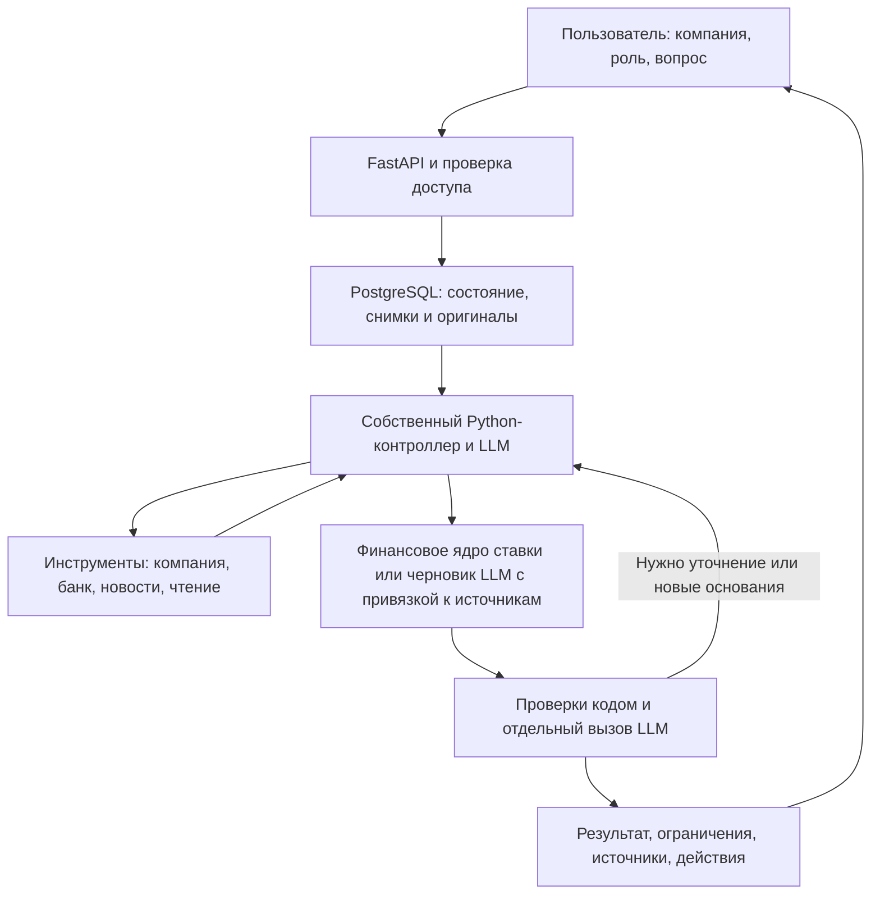

# Пульс бизнеса · 0.7.1

**Персональная новостная аналитика для руководителей крупного бизнеса.** Система связывает событие с контекстом компании, материалами Альфа-Банка и задачами конкретного руководителя: что произошло, почему это касается бизнеса, какие последствия возможны и что проверить перед решением.

Работающий прототип для кейса «Новостная аналитика для принятия бизнес-решений» хакатона Альфа-Банка. Пользователь может указать свою компанию, загрузить документы, получить подборку свежих новостей и запустить собственное исследование. Аналитику готовит собственный многошаговый Python-агент.

**[Открыть демо на Render](https://alfa-business-pulse.onrender.com)** · [Проверка требований кейса](docs/CASE_COMPLIANCE_REVIEW.md) · [Поиск и ранжирование](docs/NEWS_SEARCH_REVIEW.md) · [Источники](docs/SOURCE_REGISTER.md) · [Размещение](DEPLOYMENT.md)

Версия **0.7.1**, 26 октября 2026 года: четыре P0 после аудита. [Изменения, проверки и задачи до сдачи](docs/P0_0_7_1.md). Публикация подтверждена в [DEPLOYMENT.md](DEPLOYMENT.md). Банковская SSO и реальные счета не подключены.

### Что изменилось в 0.7.1

- Банковские фрагменты требуют содержательного совпадения; общие слова и бонус связности больше не создают релевантность сами по себе.
- Рядом с вопросом видны **период новостей** и **горизонт планирования**. Конфликт с «за 90 дней»/«на 90 дней» требует выбора; фактические настройки доходят до инструмента и экспортов.
- Карточка показывает **фактор компании → условное влияние → следующий шаг**. Происхождение, синтетичность и недостаток сведений обозначены; условия раскрываются отдельно.
- Два продолжения отчёта: **исходный снимок** или **актуальные включённые данные**. Новый расчёт не наследует старые внутренние фрагменты/резюме; оригинал и связь с ним сохраняются.

Приёмка: **320 обычных + 11 PostgreSQL/TLS проверок**, **22 локальных + 26 облачных браузерных проверок**, ошибок JavaScript нет; CI/Docker/Compose прошёл. Живой CFO-сценарий с синтетическим контекстом: 3 вызова модели / 2 инструмента, PARTIAL, новый профиль использован, исходный отчёт не изменён. [Протокол 0.7.1](validation-report-p0-071.json). Это не независимая оценка финансовой точности.

Предыдущая [приёмка 0.7.0](validation-report-v7.json): 297 тестов, 22 локальных и 26 облачных браузерных проверок; живой CFO-сценарий с синтетическим контекстом — PARTIAL, human_verified=false. [Правки созвона](docs/CALL_REWORK_0_7.md), [финансовые ограничения](docs/HARDENING_0_6.md).

### Что изменилось в 0.7.0

- **Вопрос наверху:** одна строка поиска на главной. Выдача объединяет новости из доступной подборки, точные фрагменты документов/подтверждённого контекста компании и материалы банка. Поиск не подменяет связный аналитический вывод: для него есть «Исследовать вопрос» и настройка горизонта. Внутренний вопрос не передаётся в публичный поиск.
- **Короткая сводка сразу под строкой:** три важных новости с датами, источниками и условным объяснением значимости. Полная подборка раскрывается отдельно.
- **Отдельное избранное:** сохраняются новости и исследования. У новости сохраняется исходная дата; сервер хранит прочитанный текст при его наличии. Непрочитанный заголовок остаётся наводкой. Сохранённая публикация доступна после смены подборки и может стать основанием нового исследования. Полный текст не возвращается списком в браузер. Избранное принадлежит пользователю внутри компании; до 200 новостей на пространство пользователя.
- **Отдельные отчёты:** история с пагинацией, состояния задач, сохранённые исследования и ссылки к исходному исследованию у уточнений. Фильтр избранных исследований выполняет сервер.
- **Поиск по материалам компании:** цитата, файл, страница/локатор. Исключённые из анализа файлы не участвуют в новых поисках. Профиль, загрузка и редактирование контекста сохранены.
- **План исследования:** видны фактически выполненные этапы и последний план агента, полученные фрагменты, недоступные источники и пересмотр. Предложенное уточнение запускается одним действием и наследует снимок и источники исходного исследования. Время, инструменты, бюджет и число пересмотров по-прежнему ограничены.

Быстрый поиск работает по доступным обработанным источникам; он не гарантирует полноту интернет-поиска. Совпадение с запросом не доказывает экспозицию компании. Неограниченные параллельные ветви и полный анализ всех мировых рынков не входят в этот выпуск.

### Что изменилось в 0.6.3

- Компактные экраны входа и регистрации: одна форма по центру, корректная компоновка на компьютере и телефоне. Кнопка входа видна сразу на проверенных экранах от 320×568 до 1440×900. Обновление CSS закреплено версией URL.
- Оператор может создать отдельный тестовый аккаунт одноразовой CLI-командой с солёным хешем. Существующие аккаунты и их пароли не перезаписываются; повторный запуск с тем же хешем не создаёт второе пространство. HTTP-регистрация и смена пароля сохраняют минимум 12 символов. Данные входа не входят в репозиторий и публичный HTML.

### Что изменилось в 0.6.2

- **Проверяемое ядро сценария ставки:** для свежей прочитанной публикации ЦБ о сохранении ставки финансовые механизмы и условные сценарии формирует Python. ИИ планирует исследование и выбирает основания; отдельная LLM-проверка сохранена. Другие события — проверяемый по контрактам черновик LLM, который требует вычитки. Денежный эффект и вероятность сценариев не рассчитываются.
- Серверная политика дат: выбранное окно 7/30/90/365 дней, точные согласованные горизонты, исторические цитаты отделены от новых сценариев. Неподтверждённые относительные даты и будущие сигналы о прошедших событиях блокируются.
- Финансовые ограничения проверяются кодом независимо от одобрения LLM: пауза не равна новому удорожанию, фиксированный долг не переоценивается автоматически, фактическая маржа банка не выводится из ставки без модели баланса. Проверка не доказывает финансовую истинность любого текста.
- Сообщения источника — точные цитаты с датой и модальностью; собственные выводы — условные интерпретации. Пользовательский просмотр отделён от независимой экспертизы. Невалидный вывод не публикуется как результат.
- Личные аккаунты и пароли, отзыв сессий, приглашения в команду с правами member/viewer; профессиональная роль не повышает доступ.
- PostgreSQL для рабочего состояния и оригиналов файлов; переносимые проверяемые резервные копии, восстановление в пустое хранилище. База Render Free ограничена сроком пилота, это не бессрочное хранение.
- Readiness/heartbeat, supervisor worker, ограниченный пул соединений и атомарная общая очередь. Технические метрики не являются оценкой точности аналитики.
- Исправления отраслевой релевантности и критических новостей компании; воспроизводимая синтетическая проверка ранжирования, отдельно от будущей независимой оценки поиска.

### Что изменилось в 0.5.0

- **Один профиль во всей системе:** компания и роль выбираются сверху и сохраняются между перезагрузками. Локальные фильтры ролей убраны; добавлен директор по маркетингу — CMO.
- **Диалог о компании с реальной GLM:** вопросы по роли и пробелам, предложения структурированных полей с точными цитатами, просмотр и редактирование перед подтверждением. Черновик не влияет на аналитику.
- **Полный контекст:** бизнес, продукты, аудитория, рынки, конкуренты, цели, развитие, планы продаж, финансы, риски, ограничения, темы наблюдения и свои поля. Контекст применяется в подборе, исследованиях и рекомендациях.
- **Обзор для решений:** главное событие, связь с компанией, возможный канал влияния, условия и следующий шаг. После исследования — его условные сценарии для текущей роли и версии профиля, без повторного платного запроса.
- **Связные исследования:** главный вывод, текущая ситуация, причины, опоры, сценарии и альтернативы, влияние, риски, возможности и действия. Каждый существенный пункт ссылается на источник.
- **Проверяемое прогнозирование:** горизонт, механизм, предпосылки, сигналы пересмотра и качество оснований. При нехватке данных прогноз не выдумывается. Цифры, в том числе написанные словами, проверяются вместе с единицами и масштабом.
- **Материалы банка по вашим задачам:** персональный порядок и объяснение пользы. Исторические и неподтверждённо релевантные документы доступны отдельно.
- **Проще интерфейс:** контекст перенесён на страницу компании, убрана постоянная боковая панель, сведения раскрываются по уровням. Экспорт включает всю аргументацию и сценарии.


## Для кого и какую задачу решает

Целевая аудитория кейса — руководители крупного бизнеса. Аналитика персонализируется для человека внутри компании: у одного события общее фактическое основание, но разные управленческие вопросы.

| Роль | Основной фокус |
|---|---|
| CFO — финансовый директор | Финансовый результат, стоимость финансирования, бюджет, инвестиции, существенные ограничения анализа |
| Казначей | Ликвидность, фондирование, сроки переоценки, платёжный цикл, условия финансовых инструментов |
| CEO — генеральный директор | Стратегические риски, возможности, приоритеты и вопросы к функциональным руководителям |
| COO — операционный директор | Закупки, затраты, оборотный капитал и устойчивость операций |
| CCO — коммерческий директор | Спрос, цены, продажи, условия для клиентов и конкурентная среда |
| CMO — директор по маркетингу | Поведение целевых сегментов, конкуренты, позиционирование, каналы и маркетинговые возможности |

Можно ввести другую должность; для неё предусмотрен общий срез. Роль влияет на содержание и приоритеты, а права доступа определяются владельцем рабочего пространства.

Пример сценария: **новость о ставке → профиль компании → датированная позиция банка → проверка применимости → условный вывод и действия для руководителя**. Для банковской компании рассматриваются активы и обязательства, ликвидность и процентный результат. Корпоративная формула экономии на долге к банку автоматически не применяется.

## Что умеет система

### Четыре раздела интерфейса

| Раздел | Возможности |
|---|---|
| **Обзор** | Постоянный вход в исследование, собственный вопрос, настраиваемые быстрые вопросы, контекст компании, свежие новости, история и избранное |
| **Исследование** | Свободный управленческий вопрос, дополнительный текст новости и до трёх HTTPS-ссылок, ход работы агента, результат, уточнения, источники, шесть ролевых срезов и экспорт |
| **Моя компания** | Собственные компании, описание бизнеса и сайт, загрузка и обработка файлов, признаки профиля с основаниями, конфликты и пробелы; отдельный просмотр обезличенных компаний кейса |
| **Материалы банка** | Девять аналитических PDF: темы, даты, страницы, ссылки на оригиналы, запуск вопроса по материалу и сохранённые расчётные примеры |

Интерфейс проверен на настольном экране и ширине 390/320 px. Дополнительные поля раскрываются по необходимости. «Поддержка» открывает справку о продукте. Настраиваемые быстрые вопросы хранятся в браузере отдельно для пользователя и выбранной компании.

### Вход и личное рабочее пространство

Первый вход: **создать аккаунт → ФИ, компания, должность, собственные логин и пароль → код приглашения команды**. Прежний общий пароль служит кодом регистрации; для дальнейшего входа используются личные логин и пароль. Локальный код — в игнорируемом `render-access.txt`, не в репозитории.

- Повторный вход возвращает сохранённое рабочее пространство. Пароль хранится как salted PBKDF2-SHA256, 600 000 итераций. Сессия — до 12 часов, её можно отозвать выходом; смена пароля отзывает все сессии.
- Совпадение названия работодателя не объединяет аккаунты. Владелец выдаёт одноразовое приглашение на 48 часов и выбирает права участника или просмотра; доступ можно отозвать.
- CFO/CEO/CMO и другие должности меняют аналитический срез, но не права owner/member/viewer. Доступ проверяется сервером.
- Компания и роль сверху сохраняются между входами. Смена роли сама не запускает платную аналитику. Компании кейса и два явно публичных примера доступны на чтение.
- ФИ, компания и должность сообщены пользователем. Подтверждение трудоустройства, SSO, MFA и восстановление забытого пароля пока не реализованы.

### Контекст компании через AI-диалог

На странице «Моя компания» расскажите о бизнесе естественным языком. Помощник видит сохранённые сведения, доступные признаки из документов и вашу роль, выявляет пробелы и задаёт уточняющие вопросы. Для CMO фокус — сегменты и конкуренты; для CFO — результат, финансирование и ограничения; для CEO — стратегия и развитие.

Предложения распределяются по категориям: общая информация; стратегия; продажи и финансы; риски и ограничения; информационные приоритеты; дополнительный контекст. Можно добавить собственное поле, исправить значение, исключить предложение или удалить устаревшее сведение. Название, сайт и свободное описание доступны отдельно.

**Сохранение требует вашего подтверждения.** Модель не может сама изменить профиль. Значения предложения проверяются по дословным сообщениям пользователя. Сохранённые сведения остаются сообщением компании, не получают внешнего подтверждения. Версия защищает от перезаписи более нового контекста старым предложением. Явная пометка тестового профиля сохраняется после структурирования.

Подтверждённый контекст меняет темы и объяснения новостей, подбор материалов банка, опоры исследования, сценарии и действия. Старые отчёты сохраняют исходный снимок; при смене роли или версии профиля показывается предупреждение и возможность явно создать новый анализ.

### Профиль компании из документов

Поддерживаются **PDF, DOCX, PPTX, XLSX, CSV, TXT и MD**. Агент извлекает сведения о бизнесе и финансовых факторах: деятельность, рынки, финансирование, денежный цикл и другие предусмотренные схемой признаки. Для банковской компании предусмотрены структура фондирования, разрыв переоценки, депозитная бета, ликвидность, процентный результат и достаточность капитала — если эти данные действительно есть в материалах.

Каждый принятый признак связан с файлом и цитатой. Проверяются исходное число, знак, единица, валюта и период. Неподтверждённые значения не становятся установленными показателями. Разные значения сохраняют конфликт; отсутствие данных остаётся видимым.

| Ограничение | Значение |
|---|---:|
| Размер одного файла | 15 МБ |
| Файлов / общий объём на компанию | 20 / 100 МБ |
| Извлекаемый текст одного файла | До 100 000 символов |
| PDF / страницы, требующие OCR | До 40 / до 8 |

Есть статусы обработки, скачивание исходного файла, повторное извлечение, исключение документа из активного профиля и возврат. Сканированные PDF распознаются разрешённой VL-моделью. Макросы и формулы не выполняются; изображения и графики внутри Office-файлов полностью не распознаются.

Исследование использует неизменяемый снимок профиля. Последующая загрузка, исключение или переобработка файла не переписывает старые выводы. Если текст прочитан, но модель повторно нарушила контракт извлечения, текст сохраняется с предупреждением, а невалидные показатели не принимаются.

### Автопоиск свежих новостей

На обзоре автоматически собирается подборка под выбранную компанию и роль. Период — **7, 30 или 90 дней**, по умолчанию 7.

- Основные каналы: три прямые RSS-ленты Банка России, RSS РБК и Bing News по публичному названию компании. Резервный канал — Интерфакс. Это пять основных каналов и один резервный, а не шесть независимых издателей или полный охват СМИ.
- Проверяются дата публикации, соответствие периоду, дубликаты URL и близких заголовков. Неизвестная дата не подменяется датой загрузки; будущие и противоречивые даты не становятся свежими событиями.
- Для ограниченного числа кандидатов читается статья. Статус чтения, издатель, ссылка, дата и происхождение даты показаны отдельно. Поисковая наводка сама по себе не подтверждает содержание новости.
- Собственное ранжирование учитывает связь с компанией, отраслью и известными факторами профиля, тему и роль, подтверждённые информационные приоритеты, указанных конкурентов, свежесть, источник и доступность текста. Каждая карточка показывает «Почему это важно для вашей компании», условное влияние и основания отбора. Конкурент не объявляется контрагентом или экспозицией компании.
- Балл **0–100** — порядок проверки по правилам команды. Он не означает вероятность, размер финансового эффекта или измеренную точность модели. Неподтверждённая экспозиция компании не придумывается.
- Сбор и ранжирование не вызывают LLM. Отзыв «Не по моей задаче» сохраняется для оценки качества; автоматическое обучение на отзывах не реализовано.

Подборка обновляется при открытии обзора и возврате на него; при открытом приложении повторный сбор выполняется после 15 минут. Есть ручное обновление с ограничением частоты и повтор после сбоя. При закрытом приложении push-уведомления и непрерывный мониторинг не выполняются.

Кнопка **«Разобрать для CFO»** или другой роли передаёт серверный ID новости. Сервер проверяет владельца подборки и фиксирует источник. Хотя бы одна интерпретация должна опираться на выбранное событие; заменить его старым банковским обзором нельзя.

### Кастомное исследование и работа с результатом

Можно задать вопрос о своей компании, дополнить его текстом события и ссылками либо открыть разбор выбранной новости. Открытый поиск включается отдельно. План исследования адаптируется к вопросу: переход к макроэкономике, отрасли, компании или продукту выполняется при необходимости, без обязательного полного обхода всех уровней.

Результат включает фактические основания, связь с компанией, возможные последствия и риски, условия применимости, датированную банковскую позицию при её наличии, недостающие данные, следующие проверки и ролевые действия. Источники, цитаты и краткие результаты существенных этапов доступны для просмотра.

Доступны уточняющий вопрос, ответ на запрос агента, продолжение после уточнения, отмена, явный повтор, избранное, отзыв и **скачивание Markdown-отчёта**. Уточнение сохраняет профиль и источники родительского исследования; новый самостоятельный вопрос использует актуальный профиль.

Новая записка имеет десять смысловых частей: главный вывод; что происходит; почему; что подтверждает вывод; что может произойти дальше; механизм сценария; альтернативы; влияние на компанию; риски и возможности; рекомендации. Сообщения источников, их прогнозы, интерпретации и гипотезы обозначены отдельно. Условный сценарий содержит горизонт, механизм, предпосылки, сигналы пересмотра и ограничения оснований. Базовый сценарий — рабочая гипотеза, а не доказанно наиболее вероятный исход. Численные вероятности без статистической модели не публикуются.

Аргументацию пишет отдельный этап `research_narrative`, затем Python проверяет ссылки, числовые опоры, валюты, единицы, масштаб и условия; отдельный вызов модели проверяет согласованность. При ошибке агент может исправить конкретные пункты без полного повторного поиска. Список механизмов и допустимые источники остаются под контролем сервера.

Статус **PARTIAL** означает опубликованный результат с ограничениями после предусмотренных автоматических проверок. Он не доказывает полноту исследования или истинность первоисточников.

### Расчётный сценарий ставки

Отдельно сохранён узкий сценарий по событию кейса **11 сентября 2026 года**. Это датированный пример, а не показатель текущей ставки.

Сценарий сопоставляет новость, профиль, выбранные тезисы банка и условное изменение договорной ставки. Расчёт выполняется через `Decimal`; общие основания используются в пяти ролевых представлениях. Если известен только кредитный флаг, размер плавающего долга не выдумывается: агент задаёт вопрос или показывает ограничение.

Пример на синтетических данных: **800 млн руб. × −1 п.п. × 90/365 = −1 972 602,74 руб.** изменения процентных расходов при заданных условиях. Это чувствительность к гипотетическому изменению договорной ставки, а не экономия от сохранения ключевой ставки и не оценка финансов Альфа-Банка.

## Данные и происхождение выводов

| Набор | Что подключено |
|---|---|
| `data/case/df_Uid_data_hack.csv` | 85 525 строк обезличенных профилей компаний |
| `data/case/df_Uid_payment_hack.csv` | 1 380 585 строк платёжных связей |
| `data/case/df_Fid_Uid_link_hack.csv` | 12 514 строк связей физических лиц и компаний |
| `data/bank_library.json` | OCR 64 страниц девяти банковских PDF с URL, SHA-256, страницей и датой |
| `data/demo_bundle.json` | Явно синтетические корпоративные профили, событие ставки и три выбранных структурированных банковских тезиса |
| `data/test_documents/` | Синтетические TXT и скан PDF для самостоятельной загрузки и проверки извлечения |
| Пользовательские материалы | Привязанные к личной компании файлы, сведения и ответы; в Git автоматически не добавляются |

CSV индексируются с проверкой хешей и читаются без изменения. Видны исходные признаки, наблюдаемые входящие/исходящие платежи и связи. Платежи не объявляются выручкой, кредитный флаг — остатком или типом ставки, связь с физлицом — доказательством контроля. Конфликтующие строки и отсутствующие профили не исправляются догадкой. Достоверная доля рынка автоматически не рассчитывается.

Банковская библиотека охватывает макроэкономику, ставку, инфляцию, потребление, долговой рынок, металлургию и золото. Обзор металлургии 2021 года обозначен историческим. Для золотого обзора известен месяц, точный день остаётся `null`.

Происхождение, автор утверждения, тип и модальность сохраняются отдельно: факт источника, позиция банка, модельная интерпретация, прогноз и условный сценарий не смешиваются. Цитирование ЦБ в PDF банка не превращает позицию ЦБ в собственную позицию банка. Давний прогноз не становится сегодняшним фактом.

**OCR не равен полной разметке Document/Claim/Relation/Issue.** Три выбранных тезиса имеют статус `pending_human_review`; полная ручная разметка и проверка корпуса не завершены. Агент не присваивает `human_verified` автоматически.

Первичный регламент — [ТЗ кейса](docs/source-materials/case.pdf). [Методология](docs/source-materials/labeling-methodology.pdf), [анализ аудитории](docs/source-materials/audience-analysis.docx) и [Miro](https://miro.com/app/board/uXjVEY6IJiQ=/?share_link_id=975023695519) — отдельные материалы команды. Персоны, интервью, экономия времени и запланированные тесты из DOCX не выдаются за измеренные результаты. Границы просмотра Miro и хеши исходников описаны в [реестре](docs/SOURCE_REGISTER.md).

## Архитектура и собственный агент

Стек: **Python 3.12, FastAPI, Pydantic, PostgreSQL + SQLite/FTS5, HTTPX, asyncio, HTML/CSS/JavaScript**. API обслуживает интерфейс; worker обрабатывает очереди. PostgreSQL хранит рабочее состояние и оригиналы файлов. SQLite используется для локального режима и неизменяемого поискового индекса кейса.



| Модули | Назначение |
|---|---|
| `accounts.py`, `identity.py`, `access.py`, `personalization.py` | Пользователь, принадлежность компании, подпись сессии, общие компания и роль |
| `company_dialogue.py` | Очередь интервью, вопросы GLM, проверка дословности, просмотр и подтверждение версии контекста |
| `rate_policy.py`, `analysis_policy.py`, `narrative.py`, `decision_support.py` | Связная аргументация и сценарии, числа/единицы, объяснения новостей и обзор для решений |
| `workspace.py`, `ingestion.py`, `document_parser.py` | Файлы, извлечение, кандидаты признаков, конфликты, снимки |
| `case_data.py`, `corpus.py`, `bank_library.py` | Индекс CSV, синтетические примеры, поиск по банковским страницам |
| `news.py`, `news_sources.py`, `news_ranking.py` | Публичные каналы, сбор, даты, копии, чтение, ранжирование и подборки |
| `public_sources.py` | Ограниченное HTTPS-чтение, проверка DNS/IP и редиректов |
| `research.py`, `research_rules.py` | План, инструменты, основания, интерпретация, проверка, адаптация |
| `engine.py`, `role_rules.py`, `verification.py`, `reporting.py` | Расчётный сценарий, применимость, числа и отчёт |
| `gateway.py`, `settings.py`, `prompts/` | API организаторов, разрешённые модели, контракты и лимиты |
| `postgres.py`, `storage.py`, `service.py`, `worker.py`, `supervisor.py`, `operations.py`, `bootstrap.py` | Состояние, очередь, выполнение и начальные примеры |
| `api.py`, `static/`, `cli.py` | Веб-интерфейс, HTTP API и команды запуска |

Основной цикл: **план → инструмент → сохранение наблюдений → выбор оснований и механизмов → сборка результата → проверка → публикация, изменение плана или уточнение**.

Инструменты исследователя: `company`, `bank`, `public`, `read_source`, `ask_user`, `write`. Модель выбирает действия в типизированном контракте. Python проверяет права, допустимые ID, аргументы, лимиты, цитаты и численные основания. Модель не выбирает чужую компанию, SQL, shell-команды или секреты. Инструкции внутри документов и страниц считаются входными данными.

Каталог механизмов ограничен: банковские ALM, ликвидность и кредитный риск; корпоративное финансирование, денежный цикл, спрос, затраты, валюта, конкуренция и регулирование. Это управляемая аналитика по правилам команды; произвольная финансовая модель и универсальное отраслевое исследование не реализованы.

Основные промпты — `context_interview.md`, `research_plan.md`, `research_write.md`, `research_narrative.md`, `research_verify.md`, `profile_extractor.md` и `document_ocr.md`. Планирование, выбор оснований и проверка разделены. Финальные цитаты, числа и условные формулировки контролирует сервер. Сохраняются короткие основания действий; скрытые рассуждения модели не запрашиваются.

Статусы задач: `QUEUED`, `RUNNING`, `WAITING_INPUT`, `SUCCEEDED`, `PARTIAL`, `FAILED`, `CANCELLED`, `DEFERRED_BUDGET`. Исследования хранятся в `research_jobs`, расчётные разборы — в `runs`. Платное выполнение — одна активная задача на экземпляр; публичный сбор новостей имеет отдельный цикл ввода-вывода.

Лимиты исследования: **12 вызовов модели, 8 инструментов, 2 изменения плана или исправления аргументации, 300 секунд активного выполнения**, тайм-аут API — 60 секунд. Публичный сбор: до 4 параллельных чтений, 10 статей и 85 секунд на задачу. Кэш лент — 5 минут, статей — час, ошибок — 90 секунд. Это технические ограничения, не обещание времени готовности или полноты.

### ИИ-компонент и ограничения API

Используется только API организаторов: `https://changellenge.up.railway.app/v1`. Собственный контроллер написан на Python; OpenClaw и готовые агентские runtime в приложении отсутствуют.

| Задача | Модель по умолчанию |
|---|---|
| Исследование и извлечение профиля | `z-ai/glm-5.3-flash` |
| Расчётный сценарий ставки | `qwen/qwen3.6-35b-a3b` |
| OCR сканированных PDF | `qwen/qwen3-vl-30b-a3b-instruct` |

Серверный allowlist включает только шесть ID из инструкции: три указанных выше, `google/gemma-4-26b-a4b-it`, `deepseek/deepseek-v4.1-flash`, `moonshotai/kimi-k2.6`. Настройка модели не снимает это ограничение. Внешние AI-поиск, embedding API и AI-ранжирование не подключены. OCR банковской библиотеки подготовлен заранее локальным Apple Vision; этот этап и его границы описаны в [THIRD_PARTY_NOTICES.md](THIRD_PARTY_NOTICES.md). В runtime сканы пользовательских PDF обрабатывает указанная разрешённая VL-модель.

Общий лимит ключа команды — **500 руб./день**, сброс в **03:00 МСК**. Фиксируются попытки и доступные usage-данные; при исчерпании бюджета задача откладывается до следующего сброса. Денежный остаток и стоимость запроса не выдумываются без тарифа/API баланса. Неоднозначно завершившийся платный запрос не повторяется молча.

### Доступ и передача данных

Сессия подписана отдельным серверным секретом; cookie — HttpOnly/SameSite Strict, в публичном режиме Secure. Общий пароль входа не позволяет подписать чужую сессию. Для изменяющих запросов проверяются токен страницы и допустимый Origin/Host. Файлы, снимки, задачи, избранное и отзывы проверяются по владельцу; общий кэш содержит публичные источники.

В RSS/новостной поиск передаётся только публичное название компании. ФИ, внутренние документы, показатели, вопрос и обезличенные ID туда не отправляются. Контекст исследования и необходимые фрагменты документов передаются разрешённым моделям через API организаторов. API-ключ не передаётся в браузер или промпты.

Чтение страниц ограничено HTTPS и размером ответа; внутренние/служебные IP блокируются, DNS/IP фиксируются для подключения, редиректы проверяются повторно. Эти меры реализованы в прототипе; промышленный аудит безопасности не проведён.

## Запуск из репозитория

Нужны доступ к приватному репозиторию, Git, **Python 3.12.14 и uv** для нативного запуска либо **Docker с Compose v2**. Нативный путь рассчитан на macOS/Linux; Windows — через WSL2 или Docker. Для живой аналитики нужны интернет и действующий ключ организаторов. Файлы кейса уже находятся в `data/case/`; скачивать их по старым внешним ссылкам не требуется.

```sh
git clone https://github.com/andreiczh/alfa-news-analytics.git
cd alfa-news-analytics
```

В новом клоне создайте `.env.local` и заполните три собственных значения. Если файл уже настроен, сохраните действующие секреты. Значения ниже — placeholders, их необходимо заменить:

```dotenv
ALFA_LLM_API_KEY=REPLACE_WITH_ORGANIZER_KEY
ALFA_ACCESS_PASSWORD=REPLACE_WITH_TEAM_PASSWORD_AT_LEAST_16_CHARS
ALFA_SESSION_SECRET=REPLACE_WITH_RANDOM_SECRET_AT_LEAST_32_CHARS
ALFA_AUTH_MODE=accounts
ALFA_REQUIRE_WORKER=1
```

Пароль входа и секрет подписи должны различаться. Используйте случайные значения без пробелов и shell-символов. `.env.local` не включается в Git; на macOS/Linux ограничьте доступ командой `chmod 600 .env.local`. Ключ и пароль эксперты получают отдельно от команды.

### Нативно: интерфейс и worker одной командой

```sh
uv sync --frozen --python 3.12.14
set -a
. ./.env.local
set +a
uv run alfa-agent status
uv run alfa-agent build-case-index
uv run alfa-agent serve
```

После подготовки окружения `serve` запускает API и отдельный worker. Откройте **http://127.0.0.1:8765** и создайте аккаунт с кодом регистрации из `ALFA_ACCESS_PASSWORD`; далее входите по личным логину и паролю. Остановка — `Ctrl+C`. `status` показывает наличие ключа и выбранную модель, без значения ключа.

Важно: сам `read_key` читает из `.env.local` только API-ключ. Команды `set -a` / `. ./.env.local` / `set +a` экспортируют также настройки входа и подписи; пропуск этого шага изменит локальный сценарий авторизации.

### Docker Compose: API и worker

После заполнения того же `.env.local`:

```sh
docker compose up --build
```

Откройте **http://127.0.0.1:8765**. Compose запускает API и worker, подключает общий volume `agent-state`, монтирует CSV только для чтения; индекс готовится при сборке образа. Состояние сохраняется в volume между обычными остановками контейнеров.

```sh
docker compose logs --tail=100 api worker
docker compose down
```

Dockerfile фиксирует Python 3.12.14 и устанавливает зависимости с проверкой хешей. **Docker-образ, контейнер и Compose API/worker реально собраны и запущены в [CI](https://github.com/andreiczh/alfa-news-analytics/actions/runs/40205587212).** Платные вызовы моделей проверялись отдельно на Render, не в CI.

### Переменные окружения

| Переменная | Назначение / значение по умолчанию |
|---|---|
| `ALFA_LLM_API_KEY` | Ключ организаторов; нужен для живых вызовов модели |
| `ALFA_ACCESS_PASSWORD` | Код первичной регистрации; минимум 16 символов в публичном режиме |
| `ALFA_AUTH_MODE` | `accounts` для личных аккаунтов; старый `demo` сохранён для совместимости |
| `ALFA_DATABASE_URL` | PostgreSQL DSN; без него локально используется SQLite; TLS verify-full |
| `ALFA_DATABASE_SCHEMA` | Схема PostgreSQL, по умолчанию `public` |
| `ALFA_REQUIRE_DURABLE_STORAGE` | `1` запрещает публичный запуск без PostgreSQL |
| `ALFA_REQUIRE_WORKER` | `1` включает проверку heartbeat в readiness |
| `ALFA_OPERATOR_TOKEN` | Отдельный секрет оператора для полного приватного backup, минимум 32 символа |
| `ALFA_STORAGE_EXPIRES_AT` | Известная дата завершения бесплатного хранения, показывается пользователю |
| `ALFA_SESSION_SECRET` | Независимый секрет подписи, минимум 32 символа; обязателен в публичном режиме |
| `ALFA_LLM_MODEL` | Модель расчётного сценария; по умолчанию `qwen/qwen3.6-35b-a3b` |
| `ALFA_RESEARCH_MODEL` | Исследование и профиль; по умолчанию `z-ai/glm-5.3-flash` |
| `ALFA_STATE_DIR` | Локальное состояние или кэш оригиналов при PostgreSQL; по умолчанию `var/` |
| `ALFA_STORAGE_MODE` | `local` по умолчанию; `ephemeral_demo` включает предупреждение о временном хранении, но само по себе не создаёт постоянное хранилище |
| `ALFA_CASE_DATA_DIR` | Необязательное переопределение каталога CSV; обычно `data/case/`, в Compose `/case` |
| `ALFA_PROJECT_DIR` | Корень с `data/` и `deploy/`; обычно определяется автоматически, в образе `/app` |
| `PORT` | Порт нативного сервера; по умолчанию `8765` |
| `ALFA_PUBLIC_DEPLOYMENT` | `1` для публичного HTTPS-размещения; включает обязательные секреты и Secure cookie |
| `ALFA_ALLOWED_HOSTS` | Дополнительные имена хостов через запятую, без схемы и порта; Render добавляет свой hostname автоматически |

Локальные каталоги состояния можно разделить через `ALFA_STATE_DIR`; на один каталог должен приходиться один worker. `.env*`, `render-access.txt`, `var/` и `reports/` игнорируются. Зависимости зафиксированы в `uv.lock` и `requirements.lock`.

## Пошаговая проверка для жюри

### 1. Свежие новости и кастомный вопрос: Альфа-Банк, CFO

1. Открыть демо либо локальный адрес, создать личный аккаунт с кодом команды, ФИ `Тестовый Пользователь`, компанией `Альфа-Банк` и должностью `CFO`. Эти данные — проверочный профиль, не подтверждение работы в банке.
2. В «Моей компании» отправить помощнику: «Тестовый профиль для проверки продукта. Компания — банк. Приоритеты: фондирование, ликвидность, процентный результат и спрос клиентов малого бизнеса. Конкуренты для наблюдения: Сбербанк, ВТБ. Внутренние показатели не предоставлены». Дождаться предложения, открыть просмотр изменений и подтвердить только верные сведения. До подтверждения они не должны менять профиль.
3. Вернуться на обзор и дождаться «Что важно сейчас». Проверить источник, дату, статус чтения и объяснение приоритета. Свежая подборка зависит от даты запуска и доступности издателей; конкретный заголовок не зашит в сценарий.
4. В профиле сверху сравнить CFO и CMO, затем вернуться к CFO; изменить период 7/30/90 дней. Роль должна обновить подборку, вопросы и материалы банка; перезагрузка должна сохранить выбор. Одинаковый порядок отдельных новостей сам по себе не является ошибкой.
5. Выбрать прочитанную свежую публикацию и нажать «Разобрать для CFO». Дождаться результата или явного запроса данных. Проверить, что выбранное событие присутствует среди оснований, а неизвестные внутренние показатели не придуманы.
6. Просмотреть шесть ролевых срезов, цитаты, датированный банковский материал и ограничения. Без внутренней структуры баланса допустим качественный условный вывод с `PARTIAL`.
7. Задать уточнение: «Какие внутренние данные нужны, чтобы проверить влияние на процентный результат?». Проверить сохранение исходных источников. Добавить результат в избранное, скачать Markdown, оставить отзыв.
8. Запустить отдельный вопрос без вставки новости: «Какие свежие события требуют внимания CFO Альфа-Банка и что проверить по фондированию и ликвидности?». Разрешить открытый поиск. Агент должен получить свежие основания либо явно сообщить об ограничении доступа; выдуманной новости быть не должно.

### 2. Собственная компания и загрузка файлов

1. Создать отдельную компанию `Тестовый профиль — документы` через переключатель компании. Не прикреплять синтетический финансовый профиль к реальному работодателю.
2. Загрузить [company-finance.txt](data/test_documents/company-finance.txt) и [company-strategy-scan.pdf](data/test_documents/company-strategy-scan.pdf). Дождаться обработки; распознавание скана и извлечение вызывают разрешённые модели и расходуют общий бюджет.
3. Проверить признаки и цитаты: например, синтетические сведения о плавающем долге, рынках и денежном цикле. Задать вопрос: «Какие факторы из наших документов важны для стоимости финансирования и оборотного капитала?».
4. Исключить один документ и создать новое исследование. Новый профиль должен учитывать активные файлы; предыдущий результат должен сохранить свой исходный снимок. Вернуть документ при необходимости.

### 3. Данные кейса и воспроизводимый расчёт

В переключателе найти обезличенную компанию, например `U_100110`. Проверить профиль, исходные файлы и платёжные связи. Отсутствующие условия кредита должны остаться неизвестными; реальное название компании восстанавливать нельзя.

Узкий расчётный пример можно отдельно выполнить из подготовленного нативного окружения:

```sh
uv run alfa-agent run --company demo_floating --delta -1 --days 90 --output reports/live-insight.html
```

Это **живой платный вызов** для синтетического профиля и датированного события ставки. Команда сохраняет HTML и соседний JSON с результатом. Профили `demo_missing` и `demo_fixed` позволяют проверить отсутствие суммы долга и неприменимость чувствительности плавающего долга соответственно. Запуск CLI не нужен для бесплатных автоматических тестов.

## Проверка качества и фактические результаты

```sh
uv run pytest -q
uv run ruff check src tests
node --check src/alfa_agent/static/app.js
node --check src/alfa_agent/static/decision-ui.js
```

Для последней команды нужен Node.js; runtime приложения от него не зависит. Автотесты используют выделенные тестовые ответы, не требуют ключа и не являются доказательством качества живой LLM.

Проверки предыдущего выпуска 0.4.0 от **24.10.2026**: **134 автотеста**, Ruff, синтаксис JavaScript и установка по lock-файлу прошли. Зафиксированы **22 облачные браузерные проверки**: 18 сценарных на backend `98f1ff9` и ещё 4 проверки навигации на `bb64a93`. Между ними изменена одна строка JavaScript; Python, данные, промпты и зависимости совпадают. Ошибок JavaScript в этих прогонах не зафиксировано. Подробности — [validation-report-v4.json](validation-report-v4.json).

Проверки **0.6.2**: **283 теста** с реальной PostgreSQL; [CI Docker/Compose](https://github.com/andreiczh/alfa-news-analytics/actions/runs/40205587212); **23 облачные браузерные проверки**, ошибок JavaScript 0; **6/6 ролевых сценариев** на трёх синтетических контекстах компаний и одном свежем событии о ставке. Все PARTIAL с текущими ограничениями и `human_verified=false`. Файл и шесть отчётов пережили деплои с прежними SHA-256; полный backup реально восстановлен. 100 чтений при concurrency 4 — p95 656.57 мс; 200 при 20 — p95 3876.33 мс. [Точный протокол и границы](validation-report-v6.json).

Исторические проверки **0.5.0**: **165 автотестов**, Ruff, синтаксис двух JavaScript-файлов и frozen install прошли. В облаке — **29 браузерных проверок**, 0 ошибок JavaScript: CFO/CMO, реальный AI-диалог с пятью полями и отдельным подтверждением, персональная библиотека, свежие новости, изоляция и 390/320 px. Финальное исследование свежей новости ЦБ для CFO Альфа-Банка завершилось `PARTIAL`: **6 вызовов модели / 3 инструмента / 0 изменений плана**, два условных сценария, все четыре заявленных поля контекста имеют опоры. Экспорт и повторное использование на обзоре проверены. Локальный прогон по датированным материалам банка отдельно: 5 / 2 / 1. [Точный протокол и границы приёмки](validation-report-v5.json).

Исторический холодный сбор 0.5 получил 215 уникальных кандидатов, 20 отобраны за семь дней, у 3 прочитан текст. Работали 5 из 6 каналов; РБК недоступен. В исследование выбранного события попадают дополнительные новости его темы, без соседних продуктовых публикаций только из-за упоминания компании. Это снимок запуска, не оценка полноты покрытия.

При первых живых итерациях публикация блокировалась числовыми опорами и контрактом. Исправлены резервирование опор целей/приоритетов, адресное исправление записки, ложное определение исторического года как численной вероятности и допустимая длина пояснения прогноза. Усилены проверки масштаба/валюты и значений, написанных словами. Отклонённые черновики не выдаются за успешные исследования.

Ручная финансовая вычитка отклонила и два автоматически одобренных промежуточных результата. Добавлены календарные и поэлементные опоры контекста, тип интерпретации главного вывода и банковские ограничения: пауза не равна новому удорожанию, устойчивость маржи не прогнозируется без модели баланса. Проба Qwen также пропустила спорный текст; смена модели не объявлена решением качества. Финальный результат сохраняет редакционные замечания к названию/горизонту сценария и относительной формулировке даты. Перед внешним использованием нужен просмотр аналитиком; `human_verified=false`. [Разбор итераций и critical review](docs/PRODUCT_REWORK_0_5.md).

В проверке предыдущей версии 0.4.0 «Альфа-Банк, CFO» сбор получил 216 уникальных кандидатов, 20 попали в подборку, у 6 прочитан текст. Работали 5 из 6 попыток каналов: РБК был недоступен, резервный Интерфакс сработал. Это снимок одного запуска, не метрика охвата или SLA.

В версии 0.4.0 проверены разбор выбранной свежей публикации и самостоятельный вопрос без вручную вставленной новости. Оба завершились `PARTIAL`: источники и условная интерпретация получены, внутренних банковских данных для полного финансового вывода нет. Дополнительно проверены ролевые приоритеты, экспорт, уточнения, изоляция двух одинаково заполненных входов и отсутствие горизонтального скролла на 390/320 px.

Сейчас доступны статусы, причины ошибок, попытки/usage API, количество инструментов и изменений плана, замечания проверки и отзывы. **Независимый benchmark, экспертная оценка банковских тезисов и измеренная экономия времени не получены.** В разработческом замороженном наборе 32 синтетических новости × 18 профилей/ролей средний P@5 — 0,9667 (ранее 0,8778), минимум — 0,8; critical recall@20 равен 1,0 у обеих версий. Эти числа не измеряют пропуски реальных мировых событий. Для регулярной оценки нужны размеченная отложенная выборка, сравнение по компаниям/ролям, контроль пропущенных критичных событий, ошибок атрибуции и чисел, времени/расхода вызовов и повторный прогон после изменений. Это следующий этап проверки, а не уже внедрённая система мониторинга качества.

## Покрытие требований кейса

Статусы относятся к проверенному прототипу. Это не оценка жюри и не заявление о выполнении всех критериев.

| № | Критерий ТЗ | Реализация и граница |
|---:|---|---|
| 1 | Контекст компании и значимость событий | **Частично:** CSV, документы, роль, свежая подборка; точность отбора и полнота профиля независимо не измерены |
| 2 | Многофакторная интерпретация | **Частично:** применимость, несколько механизмов, условия и действия; универсальная финансовая модель отсутствует |
| 3 | Видимый вклад аналитики Альфа-Банка | **Частично:** девять PDF, дата/страница/цитата и отдельная позиция; полная ручная разметка не завершена |
| 4 | Объединение источников и прослеживаемость | **В контуре прототипа:** CSV, внутренние файлы, банк, прочитанные внешние страницы и проверка оснований |
| 5 | Новые, заранее не показанные новости | **Частично:** живые новые события и произвольный ввод проверены; независимого репрезентативного набора нет |
| 6 | Полный пользовательский путь | **В прототипе:** вход → компания → вопрос/новость → результат → действие/уточнение; банковская интеграция смоделирована |
| 7 | Масштабирование и сопровождение | **Частично:** модули, очередь, снимки, ограничения; один экземпляр/PostgreSQL, ограниченная нагрузка и восстановление проверены; несколько инстансов и промышленный SLA не проверены |
| 8 | Метрики, регулярная оценка и обратная связь | **Частично:** журнал, проверки и отзывы; план измерений описан, регулярный независимый benchmark не внедрён |
| 9 | Постоянная точка входа на главной | **В прототипе:** обзор и поле исследования; в настоящее приложение Альфа-Бизнеса сервис не встроен |
| 10 | Уточнения, другие срезы, первоисточники | **Реализовано:** продолжение исследования, шесть ролей, цитаты, ссылки и экспорт |
| 11 | Собственная адаптивная агентная логика | **Реализовано:** план, инструменты, проверка, изменение плана, уточнение или частичный результат |
| 12 | Трассировка источников и действий | **Реализовано:** снимки, основания, промежуточные результаты, API-попытки и замечания проверки |

Полная сверка с ТЗ, методологией, анализом аудитории и Miro — в [CASE_COMPLIANCE_REVIEW.md](docs/CASE_COMPLIANCE_REVIEW.md). Веса критериев и точный момент конкурсного дедлайна не установлены доступными материалами.

### Комплект технической сдачи

| Требование со страницы 8 ТЗ | Статус |
|---|---|
| GitHub с историей и идентификатором версии | История сохранена; проверенная реализация указана выше. Финальную версию на момент дедлайна нужно зафиксировать отдельно |
| README: назначение, архитектура, окружение, конфигурация, запуск, проверка | Описано в этом документе |
| Docker и единый запуск компонентов | `Dockerfile` и `compose.yaml`, команда `docker compose up --build`; образ, контейнер и Compose API/worker прошли в CI |
| Фиксация языка и зависимостей | Python 3.12.14 в Docker/Render, `uv.lock`, `requirements.lock` с хешами |
| Сторонние компоненты, модели, данные и смоделированные интеграции | [THIRD_PARTY_NOTICES.md](THIRD_PARTY_NOTICES.md) |
| Синтетические данные и сквозной сценарий | `data/demo_bundle.json`, `data/test_documents/`, шаги проверки выше; пароль выдаётся отдельно |
| Доступ жюри к приватному репозиторию | **Не завершено:** проверка 24.10.2026 вернула `none` для `alfa-hack-2026`; владелец должен предоставить доступ и проверить принятие приглашения |
| Самостоятельный запуск экспертом | Инструкция и данные подготовлены; независимая приёмка экспертом ещё не проведена |

Точный commit текущего клона: `git rev-parse HEAD`. Последующие изменения документации не означают изменения опубликованного приложения. Конкурсная отсечка по дедлайну фиксируется командой отдельно.

## Render и оставшиеся ограничения

Демо работает на Render Free, один экземпляр; auto-deploy off. Состояние и оригиналы файлов хранятся в отдельной PostgreSQL, пережили деплои и восстановление из независимой контрольной копии. **Бесплатная БД истекает 24 ноября 2026 года.** У Free остаются холодный старт и ограничения ресурсов — [правила Render](https://render.com/docs/free). Старые временные данные версии 0.5 не объявляются автоматически перенесёнными.

Для полноценного промышленного сервиса остаются долговременный план хранения и регулярные независимые backup, SSO/MFA/восстановление доступа, масштабирование и SLA, независимая финансовая и поисковая оценка. Нет банковских операций, реальных остатков/платежей пользователя, push при закрытом приложении, полной реконструкции графиков или доказанного бизнес-эффекта. Общий LLM-черновик вне покрытого события о сохранении ставки требует содержательной вычитки. Автопроверка не заменяет финансовую экспертизу.

Перед конкурсной сдачей нужны доступ жюри, проверка банковской разметки/отложенного набора и фиксация версии. Доступ `alfa-hack-2026` проверен 25.10: `none`; приглашения не отправлялись. [Критическое ревью](docs/HARDENING_0_6.md).

## Навигация по репозиторию и развитие

- [Исходное ТЗ и материалы команды](docs/source-materials/manifest.json) — файлы, размеры и SHA-256.
- [Реестр источников](docs/SOURCE_REGISTER.md) — исходные документы, девять PDF, данные и границы использования Miro.
- [Аудит кейса](docs/CASE_COMPLIANCE_REVIEW.md) — покрытие, пробелы и критическое ревью.
- [Поиск свежих новостей](docs/NEWS_SEARCH_REVIEW.md) — источники, правила отбора, защита, результаты и ограничения.
- [Протокол 0.6.2](validation-report-v6.json) — текущие проверки, живые прогоны и статус размещения. [Протокол 0.5.0](validation-report-v5.json) — историческая версия. [Отчёт 0.4.0](validation-report-v4.json) и `v2`/`v3` относятся к предыдущим версиям.
- [Матрица продуктовых правок 0.5](docs/PRODUCT_REWORK_0_5.md) — единая персонализация, AI-диалог, исследования, сценарии и UX.
- [Размещение и откат](DEPLOYMENT.md) — конфигурация Render и границы облачной проверки.
- [Сторонние компоненты](THIRD_PARTY_NOTICES.md) — библиотеки, модели, данные, сервисы и смоделированные интеграции.

Для изменений: работайте в отдельной ветке, сохраняйте происхождение и условия утверждений, добавляйте регрессии для изменяемой логики, запускайте подходящие проверки и обновляйте документацию. Новые источники подключаются через модули сбора и реестр происхождения; новые механизмы — через типизированные правила и проверку применимости. Переход к нескольким экземплярам потребует отдельной проверки очереди, пула соединений, лимитов и распределённой эксплуатации.

Репозиторий приватный: материалы кейса, библиотека и синтетические примеры не означают разрешения на публичное распространение исходных данных. Пользовательские документы и секреты в коммиты не включаются.
